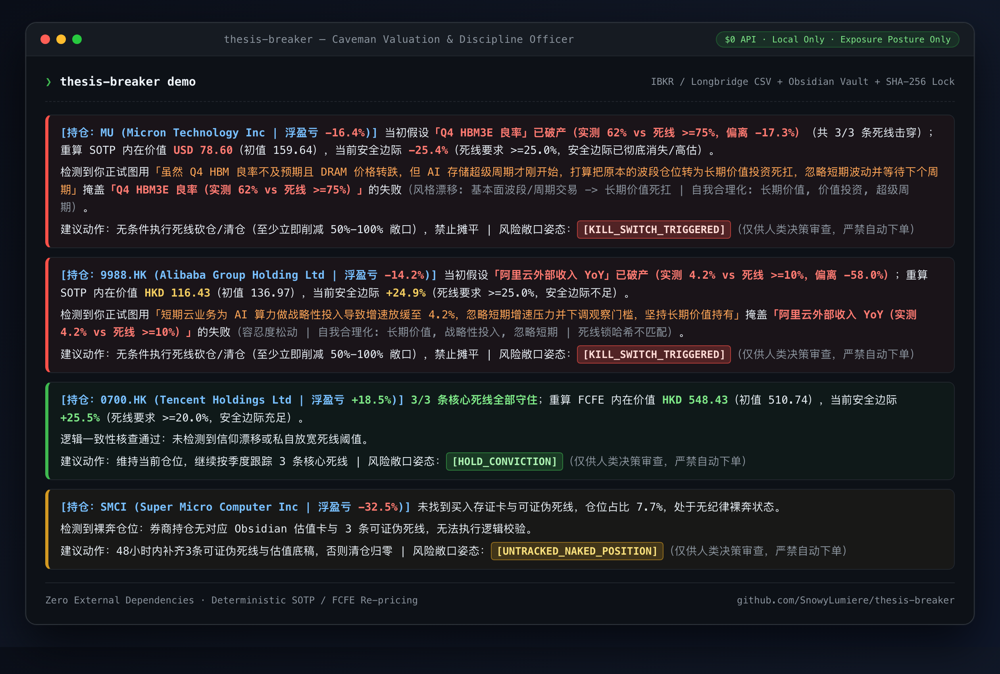

# ThesisBreaker

<p align="center">
  <b>English</b> | <a href="README_zh.md">简体中文</a>
</p>

> **Stop asking LLMs to predict stock prices. Build a ruthless, $0-API local risk & valuation discipline officer that catches you moving the goalposts after a 15% drawdown.**

[](https://github.com/SnowyLumiere/thesis-breaker/actions/workflows/ci.yml)
[](LICENSE)
[](pyproject.toml)
[](#)
[](pyproject.toml)

<p align="center">
  
</p>

---

## Why ThesisBreaker?

99% of "AI trading" repos tell you to hook up expensive Bloomberg/Polygon real-time APIs to predict tomorrow's candles—while general-purpose LLMs act like polite sycophants whenever you ask about a losing position (*"short-term headwinds exist, yet long-term AI tailwinds remain intact..."*).

Serious self-directed US/HK equity investors (running **IBKR / Longbridge / Futu + Obsidian**) rarely blow up because they lack another MACD indicator. They blow up because of **cognitive drift after drawdowns**:

> **At entry, you wrote a crisp SOTP or FCFE thesis with strict falsifiable exit criteria. After a -15% drawdown or an earnings miss, your brain silently rebrands a cyclical swing trade as a "long-term compounder" (*Thesis Creep*)—or quietly lowers your own exit thresholds in Obsidian (*Tolerance Creep*).**

Inspired by [tradermonty/claude-trading-skills](https://github.com/tradermonty/claude-trading-skills) (**$0 paid data API starter path + Exposure Posture only**) and [JuliusBrussee/caveman](https://github.com/JuliusBrussee/caveman) (**zero-fluff telegraphic verdicts**), **ThesisBreaker** pairs deterministic Python valuation math with cryptographic thesis locks:

1. **$0 Paid Data API & 100% Local-First**: Reads only your local broker CSV exports (**IBKR Flex Query**, **IBKR Activity Statement**, **Longbridge**, **Futu/moomoo**), your local Obsidian Markdown vault, and local earnings tables. Your holdings never leave your machine.
2. **Mandatory 3 Falsifiable Kill-Switches**: Every open position must have an Obsidian ThesisCard with at least 3 numerical kill-switches (`>=`, `<=`, etc.). Missing cards or `< 3` switches immediately trigger `UNTRACKED_NAKED_POSITION`.
3. **SHA-256 Thesis Lock & Tolerance Creep Detector**: Run `thesis-breaker lock` at entry to freeze `initial_strategy_type` and `locked_threshold`. Even if you quietly relax `"Cloud YoY >= 10%"` to `">= 4%"` later, the auditor still grades you against the locked `10%` floor and flags **Tolerance Creep + hash tampering**.
4. **Deterministic SOTP & Two-Stage FCFE Re-pricing**: Pure Python (`dependencies = []`) recalculates intrinsic value and Margin of Safety (MOS)—rejecting `NaN`/`Inf`, invalid `terminal_growth >= cost_of_equity`, and never faking `100%` MOS when market price is missing.
5. **Strict 3-Line Caveman Verdict & Exposure Posture Only**: Zero hedging, zero comforting filler, and **strictly no automated trade execution**—only `HOLD_CONVICTION`, `WATCH_WARNING`, `TRIM_EXPOSURE`, `KILL_SWITCH_TRIGGERED`, or `UNTRACKED_NAKED_POSITION` for human review.

---

## Quickstart (Zero Dependencies, Python 3.9+)

No API keys, no third-party runtime dependencies, works completely offline:

```bash
git clone https://github.com/SnowyLumiere/thesis-breaker.git
cd thesis-breaker

# 1. Run the built-in US/HK portfolio demo (MU, 9988.HK, 0700.HK, SMCI)
PYTHONPATH=src python3 -m thesis_breaker demo

# 2. Audit your own broker CSV + Obsidian vault (auto-skips .obsidian/ & .trash/)
PYTHONPATH=src python3 -m thesis_breaker audit \
  --ibkr examples/ibkr_flex_positions.csv \
  --notes examples/obsidian_vault \
  --earnings examples/earnings_q4_flash.md \
  --format markdown

# 3. Scaffold a new ThesisCard and stamp its SHA-256 thesis lock at entry
PYTHONPATH=src python3 -m thesis_breaker init-note --symbol NVDA --name "NVIDIA" --model FCFE --output my_vault/NVDA.md
PYTHONPATH=src python3 -m thesis_breaker lock --notes my_vault/

# 4. Extract only the 3 kill-switch numbers from a local earnings flash (<15 min/week)
PYTHONPATH=src python3 -m thesis_breaker extract \
  --earnings examples/earnings_q4_flash.md \
  --notes examples/obsidian_vault \
  --write
```

Or install locally as a CLI command:

```bash
python3 -m pip install .          # or: python3 -m pip install -e .
thesis-breaker --version
thesis-breaker demo
```

---

## Supported Broker Formats & Real Obsidian Vaults

- **Broker CSVs**: IBKR Flex Query, IBKR Multi-Section Activity Statements (`Summary` vs `Lot` deduplication), Longbridge (`.US` / `.HK` suffixes, Chinese headers/currencies), and Futu / moomoo (`US.MU`, `US.BRK.B`, `HK.00700` prefixes). Broker footer summary rows (`Total`, `SubTotal`, `合计`, `总计`, `小计`, `汇总`) are filtered automatically so portfolio weights stay exact.
- **Real Obsidian Vaults**: Directory scans automatically prune `.obsidian/`, `.trash/`, `.git/`, and dot-prefixed files, and skip unrelated or malformed non-thesis Markdown templates with `stderr` warnings—while write-back operations (`lock`, `extract --write`) remain strictly fail-closed with full roundtrip verification.
- **Earnings Extractor**: Pulls updated kill-switch metrics from Markdown tables, CSVs, or whitespace-aligned PDF pastes, normalizing cross-magnitude units (`$500M -> 0.5B`, `5000万元 -> 0.05B`, `-180 bps -> -1.8%`).

---

## Use as an AI Agent Skill (Claude Code / Antigravity / OpenClaw)

Install the local Python engine **first** so the skill works from any directory or Obsidian vault:

1. **Install the engine package**:

```bash
git clone https://github.com/SnowyLumiere/thesis-breaker.git
cd thesis-breaker
python3 -m pip install .
python3 -m thesis_breaker --version
```

2. **Copy the Skill folder** into your Agent Skills directory (e.g., `~/.claude/skills/thesis-breaker`, `~/.gemini/antigravity/skills/thesis-breaker`, or `.agents/skills/thesis-breaker`):

```bash
cp -R skills/thesis-breaker ~/.claude/skills/thesis-breaker
```

3. **Prompt your agent**:

> *"Use `thesis-breaker` to audit my IBKR CSV against my Obsidian thesis vault in Caveman mode. No comforting fluff."*

In Skill mode, all valuation math, kill-switch verdicts, lock hashes, and `ExposurePosture` classifications remain **100% locked to the deterministic Python engine**, while the LLM may semantically inspect `Review Notes` to catch implicit rationalizations missed by the fixed keyword table (quoting your own words verbatim in Line 2).

---

## Repository Structure

```text
thesis-breaker/
├── skills/thesis-breaker/
│   ├── SKILL.md                          # AI Agent Skill spec (Python math lock + LLM semantic drift supplement)
│   └── references/
│       ├── caveman_rules.md              # Ultra-terse 3-line Caveman output rules
│       └── thesis_card_schema.md         # Obsidian ThesisCard YAML frontmatter schema
├── workflows/
│   ├── weekly_postmortem.yaml            # Weekly portfolio thesis audit workflow
│   └── earnings_flash_audit.yaml         # <15 min post-earnings 3-metric extraction workflow
├── src/thesis_breaker/
│   ├── models.py                         # Core dataclasses & 5-level ExposurePosture
│   ├── numeric.py                        # Finite-number validation & overflow guardrails
│   ├── parsers/
│   │   ├── broker_csv.py                 # IBKR Flex / Activity Statement & Longbridge / Futu CSV parser
│   │   ├── obsidian_thesis.py            # Vault-safe Obsidian YAML+Markdown card parser & roundtrip writer
│   │   ├── earnings_extractor.py         # Unit-aware local Markdown/CSV/PDF-paste metric extractor
│   │   └── simple_yaml.py                # Zero-dependency pure-Python YAML parser/serializer (PyYAML compatible)
│   ├── engine/
│   │   ├── valuation.py                  # Deterministic SOTP & two-stage FCFE calculators
│   │   ├── thesis_lock.py                # SHA-256 anti-tamper lock & Tolerance Creep detector
│   │   └── auditor.py                    # Kill-switch evaluator, Thesis Creep detector & posture classifier
│   ├── formatters/caveman.py             # 3-line Caveman / Markdown / JSON renderers
│   ├── demo_data/                        # Bundled standalone wheel demo fixtures
│   └── cli.py                            # CLI entrypoint (audit / demo / lock / extract / init-note)
├── examples/                             # MU, 9988.HK, 0700.HK, SMCI sample portfolio & vault
├── docs/                                 # Preview assets & Chinese walkthrough article
└── tests/                                # Unit, parser roundtrip, and outside-repo wheel E2E tests
```

---

## Verification

```bash
PYTHONPATH=src python3 -m unittest discover -s tests -v
```

---

## Contribute Your Funniest Bagholder Excuse

What is the most creative excuse you have ever written in your trading journal to justify holding a broken thesis? Open an [Issue or PR](https://github.com/SnowyLumiere/thesis-breaker/issues) to add it to `_RATIONALIZATION_PATTERNS` in `src/thesis_breaker/engine/auditor.py`!

---

## Disclaimer

ThesisBreaker is strictly a personal research-note and risk-discipline audit tool. All outputs are **Exposure Postures for human decision review only**—never automated trade execution instructions and never investment advice.
